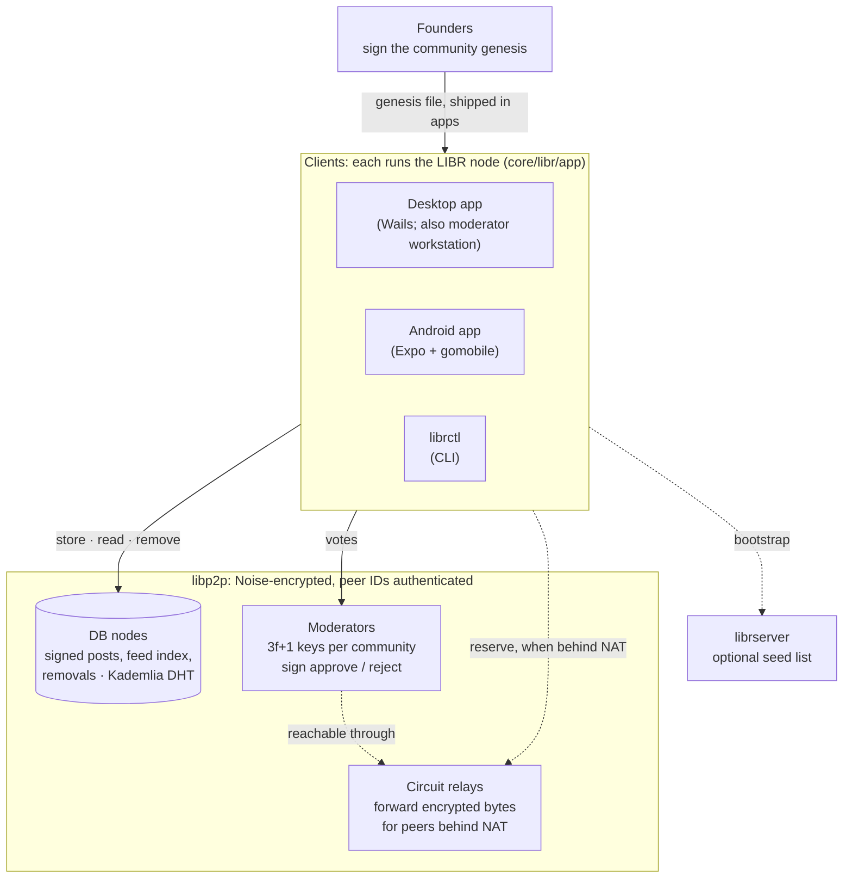
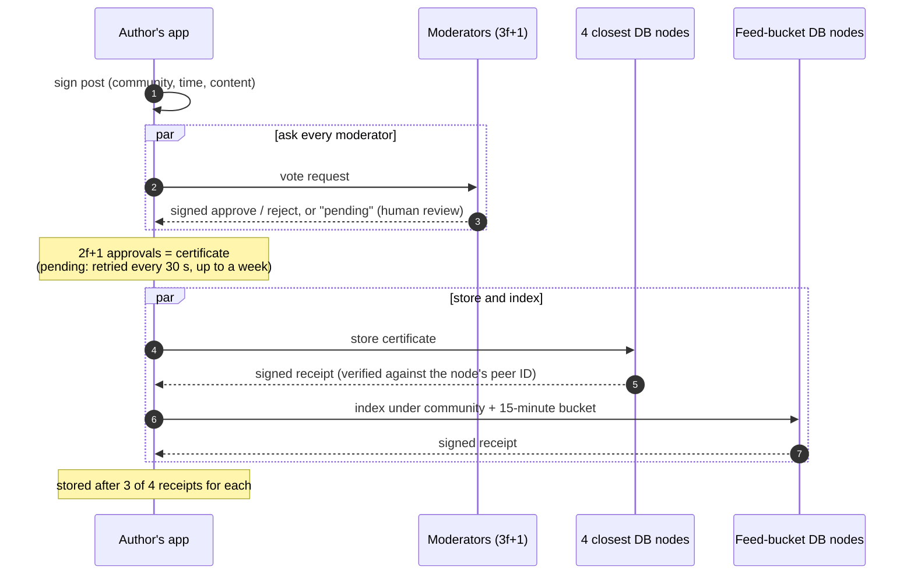

# LIBR

> A moderated, censorship-resilient, decentralized forum.

LIBR lets a community run a public forum that no single server controls but that is
still moderated. Posts are stored on many independent storage nodes; a post appears
only when a quorum of the community's moderators has signed it, and it is removed only
by a quorum (or by its author). Every reader checks those signatures itself, so a
storage node or relay that lies is caught, not trusted.

**Website:** [libr.social](https://libr.social) · **Status:** v2 (this code) is complete
and tested but its public network has not launched yet; see
[#78](https://github.com/libr-forum/libr/issues/78). Want to run a relay or DB node, or
moderate a community? Open an issue, the setup is in [`docs/RELEASE.md`](docs/RELEASE.md).

## Architecture



* **Communities** are defined by a genesis file: the moderator set (3f+1 keys, f faulty
  tolerated), signed by the community's founders. Apps ship these files.
* **Posting**: the author signs the post and asks every moderator; at 2f+1 approvals
  the certificate is stored on the 4 DB nodes closest to its hash and indexed in the
  community's 15-minute feed bucket. It counts as stored after 3 signed receipts.
* **Human review**: moderators can defer a post (images by default) or a report to a
  person. The app keeps the item and retries until a quorum has decided (≤ 1 week).
* **Removal**: a moderator quorum (after a report) or the author signs a tombstone;
  DB nodes delete the content and refuse new copies of that message.
* **Reading**: a client fetches the feed index from two nodes, then every post by
  hash, and keeps only posts that hash correctly and carry a valid quorum.

### Posting a message



### Reading and removal

```mermaid
sequenceDiagram
    autonumber
    participant R as Reader's app
    participant I as Feed-bucket DB nodes
    participant D as DB nodes holding posts
    R->>I: index for each 15-minute bucket (2 nodes)
    I-->>R: post hashes + tombstones
    R->>D: fetch each post by hash
    D-->>R: certificate
    Note over R: keep only posts that hash correctly, carry 2f+1 valid<br/>moderator signatures and have no verified tombstone
    Note over R,D: Removal: a moderator quorum (after a report) or the author signs a<br/>tombstone; DB nodes delete the post and refuse new copies of it
```

Details: [`core/libr`](core/libr) packages, [`docs/v2-limits.md`](docs/v2-limits.md)
(abuse limits and known gaps), [`docs/RELEASE.md`](docs/RELEASE.md) (deploying a
network and releasing).

## Repository

| Path | What |
|---|---|
| `core/libr` | Shared Go core: `proto` (signed objects), `p2p`, `wire`, `dbnode`, `moderator`, `forum` (client), `app` (node used by both apps), `seeds`, `cmd/librctl` |
| `core/db` | DB node binary (SQLite) |
| `core/mod_client` | Desktop app: client and moderator workstation (Wails, React) |
| `mobile-app` | Android app (Expo / React Native) and its Go bridge (`go-core/`) |
| `services/relay` | Circuit relay |
| `services/librserver` | Seed server (in memory, no database) |
| `testbed/` | Docker end-to-end test network; LAN dev network for the apps |
| `deploy/` | Production compose file for relays, DB nodes and the seed server |

## Quick start: a whole network on your machine

Requirements: Go 1.24.4, Node 22, Docker.

```bash
testbed/e2e.sh                     # Docker: relays, NATed DB nodes, 4 mods, 2 clients, fault tests
DEVNET_IP=<your LAN ip> testbed/devnet.sh start   # long-running LAN network for the apps
```

`devnet.sh` prints the `LIBR_RELAYS`, `LIBR_BOOTSTRAP` and `LIBR_COMMUNITIES`
settings for clients. With those exported, the CLI posts and reads:

```bash
cd core/libr
go run ./cmd/librctl client submit -community general -text "hello"
go run ./cmd/librctl client feed -community general
```

`EXTRA_MODS=<base64 public key>` makes an app identity one of the dev network's
moderators.

## Desktop app

```bash
cd core/mod_client/frontend && npm ci && cd ..
LIBR_RELAYS=... LIBR_BOOTSTRAP=... LIBR_COMMUNITIES=... wails dev -tags webkit2_41
wails build -tags webkit2_41        # binary in build/bin/
```

Drop `-tags webkit2_41` outside Ubuntu 24.04-style WebKitGTK 4.1 systems. Moderators
configure automated review (forbidden words, LLM provider: Groq, Gemini, OpenAI,
DeepSeek, or Google NLP) under **Mod Config**; API keys stay in the local config
directory. If the classifier is unavailable, posts go to the human review queue.

## Android app

```bash
cd mobile-app/go-core && ./build-android.sh   # builds android/app/libs/libr-core.aar
cd .. && npm ci
EXPO_PUBLIC_LIBR_RELAYS=... EXPO_PUBLIC_LIBR_BOOTSTRAP=... npx expo run:android
```

For a dev network also set `EXPO_PUBLIC_LIBR_COMMUNITY` to the genesis JSON. Release
builds use the communities and seeds built into the Go core.

## Running network infrastructure

Relays and DB nodes are plain processes configured by environment variables (see the
headers of `services/relay/relay.go` and `core/db/main.go`). `deploy/compose.yml` runs
them on a public host; [`docs/RELEASE.md`](docs/RELEASE.md) is the full checklist,
including how founders sign a community's genesis on their own machines.

## Security model in one paragraph

Keys never leave the device. Relays and DB nodes are untrusted: every connection is
Noise-encrypted and authenticated to the peer ID the dialer asked for, every stored
object is signed, and clients verify receipts and posts themselves. Safety needs at
most f faulty moderators out of 3f+1 per community. Relays still see who talks to
whom (not what), and some abuse limits are coarse; both are listed in
[`docs/v2-limits.md`](docs/v2-limits.md). Report vulnerabilities as described in
[SECURITY.md](SECURITY.md).

## Contributing

See [CONTRIBUTING.md](CONTRIBUTING.md) (tests, commit format, branches) and, if you
are new, [docs/BEGINNER_GUIDE.md](docs/BEGINNER_GUIDE.md).

## License

[MIT](LICENSE)
