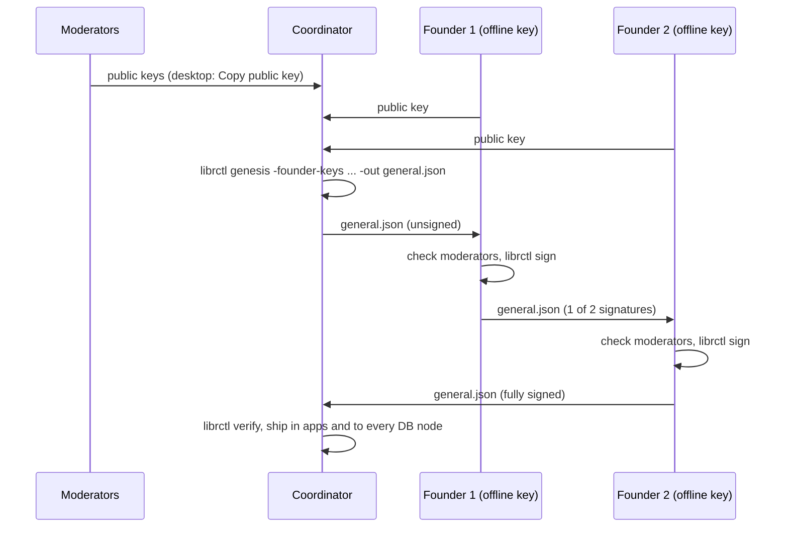
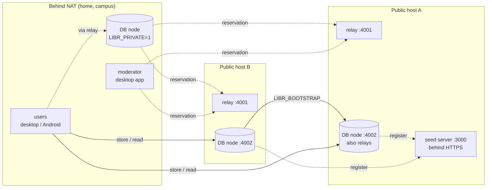

# Releasing LIBR and running a network

A LIBR network is: **communities** (signed genesis files), **relays**, **DB nodes**,
optionally a **seed server**, and the **apps**, which have all of it built in. This
guide sets one up from nothing and cuts a release. Do the steps in order; each ends
with a check.

## 0. Keys and who holds them

| Key | Who | Where | If lost / leaked |
|---|---|---|---|
| Founder key (one per founder) | each founder, **offline** | a USB stick or an air-gapped machine; never on a server | Lost: the existing genesis stays valid, but a new one needs every founder, so a replacement genesis must name a new founder set. Leaked: the attacker can sign a rival genesis, but apps and nodes only trust the file shipped to them, so nothing changes unless you ship theirs. |
| Moderator key | each moderator | their desktop app identity (`~/.config/libr/keys/priv.key`, `%APPDATA%\libr\keys`, `~/Library/Application Support/libr/keys`) | Leaked key = one faulty moderator; the community tolerates f of them. Replace it with a new genesis (until epoch hand-off exists). |
| Relay key | relay operator | `RELAY_PRIV_KEY` in `deploy/.env` | It is the relay's peer ID in every shipped app; changing it means a new release. Back it up. |
| DB node key | DB node operator | `node.key` in the DB node's data volume | Same: shipped bootstrap peers name it. Back it up. |

Never commit any of these. `deploy/.env` and `deploy/communities/` are git-ignored.

Generate any key with `librctl keygen -out <file>` (prints peer ID and base64 public
key; `-libp2p` also prints the relay-format private key). `librctl` comes with each
GitHub release (`librctl-<os>-<arch>`) or `go build ./cmd/librctl` in `core/libr`.

## 1. Create each community

A community needs **3f+1 moderators** (4 for f=1, 7 for f=2) and a decision takes
2f+1 of them. Pick f so that more than f moderators being malicious or compromised at
once is unlikely.

1. Each moderator installs the desktop app and sends their **public key** to the
   coordinator (identity dialog → **Copy public key**; base64, 44 characters).
2. Each founder runs `librctl keygen -out founder.key` on their own offline machine and
   sends the **public key** (second field) to the coordinator.


3. The coordinator writes the unsigned genesis:
   ```bash
   librctl genesis -community general -f 1 \
     -mods <mod1>,<mod2>,<mod3>,<mod4> \
     -founder-keys <founder1>,<founder2> -out general.json
   ```
4. The file goes to each founder in turn, who checks the moderator list and runs
   `librctl sign -key founder.key -in general.json`.
5. **Check:** `librctl verify -in general.json` prints
   `ok: community "general", 4 moderators, threshold 3 (f=1), signed by all 2 founders`.
   Nodes and apps refuse the file until it does.

## 2. Deploy relays and DB nodes



Minimum for a usable network: **2 relays** on different hosts and **at least 4 DB
nodes** (posts are stored on the 4 closest), better 6+, run by different people.
On each public host (a VPS with a public IP, ports 4001/4002 tcp+udp open):

```bash
git clone https://github.com/libr-forum/Libr.git && cd Libr/deploy
cp .env.example .env            # fill in PUBLIC_IP, RELAY_PRIV_KEY, ...
mkdir communities && cp /path/to/general.json communities/
docker compose --env-file .env --profile relay --profile db up -d
```

* The **first** DB node has empty `LIBR_BOOTSTRAP`; every later one points at earlier
  ones (`/ip4/<ip>/tcp/4002/p2p/<id>`; the id is in `docker compose logs db`).
* Behind NAT (home servers) run the DB node with `LIBR_PRIVATE=1` and `LIBR_RELAYS`
  set instead (see `core/db/main.go`); it is reachable only through relays.
* A node may refuse communities with `LIBR_OPTOUT` (legal reasons); the network routes
  around it.
* Every DB node needs every community file in `communities/`: unknown communities are
  refused.
* **Check:** `curl localhost:8080/health` on relay hosts; `docker compose logs db` shows
  `joined the DHT; routing table N` with N ≥ number of other DB nodes.

Optional seed server (lets the network grow beyond the shipped list): add
`--profile seed`, put HTTPS in front of `127.0.0.1:3000` (Caddy:
`seed.example.org { reverse_proxy 127.0.0.1:3000 }`), and set `LIBR_SEED_URLS` on DB
nodes so they register. The old Render deployment of librserver also works
(`services/librserver/render.yaml`); it keeps no data.

## 3. End-to-end check before shipping

From a machine outside the hosts' network, with `librctl` and the community file:

```bash
export LIBR_COMMUNITIES=./communities
export LIBR_BOOTSTRAP=/ip4/<db1>/tcp/4002/p2p/<id>
export LIBR_RELAYS=/ip4/<relay1>/tcp/4001/p2p/<id>,/ip4/<relay2>/tcp/4001/p2p/<id>
librctl client feed -community general     # works with no moderators online
```

Posting needs 2f+1 moderators online: have them start the desktop app (it joins as
moderator automatically when its key is in a community), then
`librctl client submit -community general -text "launch test"` must print
`votes=3 receipts>=3 indexed>=3`. Stop one relay and repeat.

## 4. Build the network into the apps

1. `core/libr/seeds/seeds.json`: the DB node bootstrap addresses, both relays, and the
   seed URL (https only):
   ```json
   { "bootstrap": ["/ip4/…/tcp/4002/p2p/…"], "relays": ["/ip4/…/tcp/4001/p2p/…"], "seed_urls": ["https://seed.example.org"] }
   ```
2. Community files into `core/libr/app/communities/` (one `<name>.json` each).
3. `go test ./seeds ./app` in `core/libr` (checks the seed list parses and https).
4. Commit on `staging`, PR to `main`.

## 5. Release

Checklist (copy into the release PR):

- [ ] CI green on `main`: Go `-race` in every module, lint, frontend, mobile, seed server, gomobile bind, Docker images
- [ ] E2E workflow green (testbed + nightly fuzz) on the release commit
- [ ] `librctl verify` passes for every shipped community file
- [ ] Section 3 check passes against the production network
- [ ] Desktop: `wails build -tags webkit2_41` on Linux; macOS/Windows builds; post, report, delete, and (as a moderator) approve an image from the review page
- [ ] Android: `mobile-app/go-core/build-android.sh`, then `cd mobile-app/android && ./gradlew assembleRelease`; install on a device; post, read, report, delete; app restarts keep pending items
- [ ] `CHANGELOG.md` updated by the changelog workflow; breaking changes called out
- [ ] Tag: `git tag vX.Y.Z && git push origin vX.Y.Z` (release workflow attaches relay, `librctl` and DB node binaries; packages via `scripts/build-packages.sh`)

Android notes: gomobile is pinned in `mobile-app/go-core/go.mod`; install `gobind` from
there (`go install golang.org/x/mobile/cmd/gobind`) and never run `gomobile init`,
which fetches `@latest`. Build with `GOWORK=off` (the script does).

## 6. Cutting over from v1

v1 and v2 do not interoperate (new protocols, fresh storage; v1 posts are not migrated).

1. Deploy the v2 network (steps 1–3) while v1 keeps running.
2. Release v2.0.0 apps (steps 4–5). v1 apps keep working against v1 until step 3 here.
3. Announce, then shut down v1: the v1 relay service on Render, the v1 librserver
   (redeploy `services/librserver` from `main`: it becomes the v2 seed server and the
   v1 `/mods` and `/relays` endpoints disappear), and the v1 DB nodes.
4. Delete the MongoDB Atlas cluster and revoke its users: v2 stores nothing in MongoDB.
